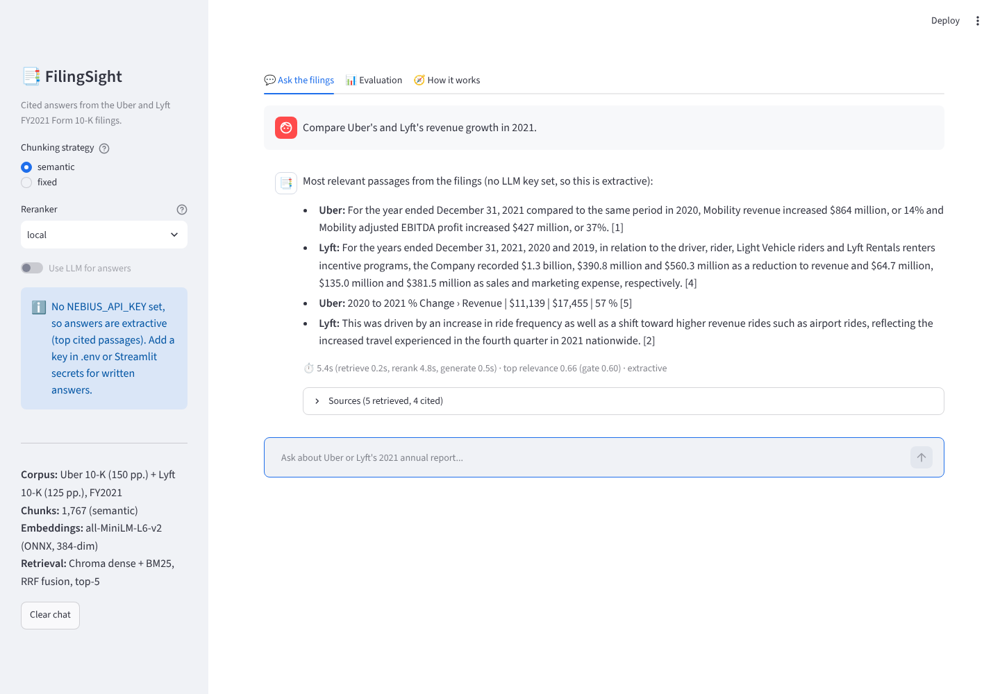

# 📑 FilingSight: cited Q&A over Uber and Lyft 10-K filings

A RAG application that answers questions about the **Uber and Lyft FY2021 annual reports (Form 10-K)** with page-level citations, and says *"I could not find this"* instead of guessing.

Built for **The Gen Academy, Mastering Agentic AI, Week 2 (Build Your RAG Application)**.
Use case: **Project 2, Financial Document Intelligence Pipeline**. Track: **Track 2, LangChain + LangGraph**, plus the optional **chatbot UI** add-on.


> **One-liner:** FilingSight helps retail investors and junior equity analysts answer metric, risk and strategy questions from the Uber and Lyft FY2021 Form 10-K filings (275 pages) in a cited chat app, with ≥ 90% faithfulness and ≥ 90% hit@5 retrieval relevance, within an 8-second answer.



## Headline results (25 labelled questions)

| Configuration | Hit@5 | MRR@10 | Unanswerable refused | False refusals |
|---|---|---|---|---|
| Fixed chunks, dense only (baseline) | 0.65 | 0.55 | n/a | n/a |
| Fixed chunks, hybrid + rerank | 0.90 | 0.83 | 100% | 0% |
| **Semantic chunks, hybrid + rerank (default)** | **0.95** | **0.87** | **100%** | **0%** |

Semantic chunking beat fixed-size chunking in every retrieval mode, and reranking added +10 points of hit@5 on top of hybrid search. Full comparison and failure analysis: [docs/EVALUATION.md](docs/EVALUATION.md).

## How it works

```
analyze ──(year outside 2019-2021)──────────────────────► refuse
   │
retrieve: one hybrid search per company
          (Chroma dense + BM25, Reciprocal Rank Fusion, company metadata filter)
   │      → rerank → company-balanced top-5
   ▼
gate ──(top relevance < 0.60)───────────────────────────► refuse
   │
generate (Nebius Llama-3.3-70B with numbered sources | extractive fallback)
   │
validate_citations ──(NOT_FOUND)────────────────────────► refuse
   └──(no valid [n] citation on first try)──► generate again
```

| Layer | Decision and why |
|---|---|
| **Corpus** | Uber and Lyft 10-K, FY2021 (public SEC filings, PDF, English; SEC/EDGAR is the source of truth). 307 + 238 PDF pages, of which 275 body pages are kept. Two direct competitors make comparison questions possible. |
| **Ingestion + cleaning** | PyMuPDF text (pypdf glued words together). Exhibits after the Exhibit Index dropped, page numbers stripped, table cells re-joined into rows (`Revenue \| $11,139 \| $17,455 \| 57 %`), wrapped lines re-flowed, curly quotes normalised, every page tagged with company, page and 10-K Item. |
| **Ingestion + freshness** | Batch: `python scripts/build_index.py` rebuilds chunks and embeddings (~5 min on a laptop). 10-Ks are annual, so the SLA is "re-index within a day of a new filing"; adding a filing is one line in `config.FILINGS`. |
| **Chunking + embedding** | Compared **fixed** (900 chars / 150 overlap) and **semantic** (embedding breakpoints at the 85th percentile, capped at 1,100 chars). Embeddings: all-MiniLM-L6-v2 (384-dim, ONNX on CPU, free). Chunk size is matched to MiniLM's 256-token window. Each chunk gets a header (`Lyft 10-K FY2021 \| Item 7 MD&A \| p.57`) so "Lyft revenue" matches paragraphs that only say "we". |
| **Retrieve** | Chroma (cosine) + BM25 fused with RRF; 20 candidates per company; company metadata filter; comparison and no-company questions are split into one sub-query per company. |
| **Rerank** | `local` reranker (best-sentence similarity + whole-chunk similarity + key-term coverage, no download), with `cross-encoder` (ms-marco-MiniLM) and `llm` options. Final top-5 keeps a fair share per company. |
| **Refusal ("I don't know" path)** | Designed first: year-scope rule, confidence gate on the reranker score, the LLM's `NOT_FOUND` contract, and citation validation. |

## Quick start

```bash
# Windows: double-click run.bat
# macOS/Linux:
./run.sh
# or manually:
python -m venv .venv && source .venv/bin/activate   # Windows: .venv\Scripts\activate
pip install -r requirements.txt
cp .env.example .env        # add NEBIUS_API_KEY for written answers
streamlit run app.py
```

Without an API key the app still works end to end: retrieval, reranking and refusals run locally, and answers are the top cited passages (extractive mode). With `NEBIUS_API_KEY` set, answers are written by `meta-llama/Llama-3.3-70B-Instruct` on Nebius AI Studio (any OpenAI-compatible endpoint works via `FS_LLM_BASE_URL`).

The search index (chunks + embeddings for both strategies) is committed in `data/processed/`, so the app starts in seconds. Rebuild it with `python scripts/build_index.py`.

## Evaluate

```bash
python eval/run_retrieval_eval.py                 # chunking x retrieval x reranking matrix (no key needed)
python eval/run_retrieval_eval.py --rerankers none local cross-encoder   # after: pip install -r requirements-optional.txt
python eval/run_answer_eval.py                    # end-to-end with LLM + LLM-judge faithfulness (needs a key)
python eval/run_answer_eval.py --no-llm           # end-to-end, extractive mode
pytest -q                                         # 19 tests incl. a retrieval-quality regression guard
```

Results land in `eval/results/` and show up in the app's **Evaluation** tab.

## Project layout

```
app.py                      Streamlit chat UI (Ask / Evaluation / How it works tabs)
src/filingsight/
  config.py                 corpus list and every tunable (env-overridable)
  ingest.py                 PDF -> cleaned, tagged pages
  chunking.py               fixed vs semantic chunkers
  embeddings.py             MiniLM ONNX embeddings as a LangChain Embeddings class
  index.py                  build/save/load Chroma + BM25 indexes
  retrieval.py              query planning, dense / BM25 / hybrid (RRF), company-balanced selection
  rerank.py                 local, cross-encoder and LLM rerankers
  pipeline.py               plan -> retrieve -> rerank -> select (shared by app and eval)
  graph.py                  LangGraph state machine (analyze, retrieve, gate, generate, validate, refuse)
  prompts.py                every prompt
  evaluation.py             evidence-phrase metrics (fair across chunkers)
data/raw/                   the two 10-K PDFs
data/processed/             committed chunks + embeddings
data/eval/questions.json    25 questions with reference answers and evidence labels
eval/                       evaluation scripts and results
docs/                       evaluation report, prompts and iterations, video script, screenshots
```

## Deploy (optional)

Push to GitHub with `push-to-github.bat`, then on [share.streamlit.io](https://share.streamlit.io) create an app from `balum211/FilingSight`, main file `app.py`, and add `NEBIUS_API_KEY = "..."` under **Advanced settings → Secrets**.

> For learning purposes only, not investment advice. Figures come from FY2021 filings and are not current.
